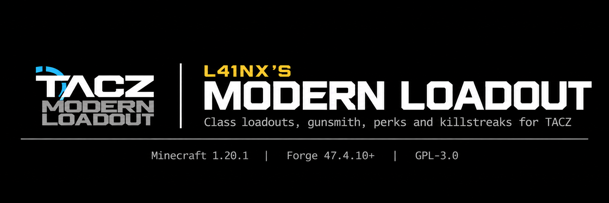

<p align="center">
  
</p>

<p align="center">
  
  
  
  
  
</p>

# L41NX's Modern Loadout

A class and loadout system for [TACZ](https://github.com/MCModderAnchor/TACZ) servers, in the style of modern
military shooters. Players build classes (guns, attachments, equipment, perks), the server decides when they
may change them, and you get killstreaks, a Specialist mode and per-gun levels on top.

It is only the loadout system. There is no matchmaking, no scoreboard and no team logic, and it does not touch
armor. You bring the game mode; this handles what people carry into it.

Install it on the **client and the server**. TACZ is required, everything else is optional.

> Status: **1.1.0**, the first step of the MW4-style UI. The mod has been on test servers since mid-2026; the
> [changelog](CHANGELOG.md) lists what changed and what is still rough, and [docs/HISTORY.md](docs/HISTORY.md) tells how it got here.

<!-- TODO(L41nx): add real in-game screenshots (1920x1080) as docs/img/shot-classes.png, shot-gunsmith.png, shot-perks.png
     and turn this back into a table:
| Class screen | Gunsmith | Perks and Specialist |
|---|---|---|
|  |  |  |
-->

## What it does

**Classes**
- Up to 20 saved classes per player (the admin can change the limit), rename, pin, duplicate, reset, randomize.
- Nine slots: primary, secondary, melee, consumable, lethal, tactical and three extra Field Upgrade slots (those three
  stay hidden until an admin stocks and enables them). Every slot is configurable by the admin: categories, whitelist or
  blacklist, counts, defaults, locked or hidden.
- Save is always allowed. Equip puts the class on you right away if the edit rules allow it, otherwise the class is
  remembered and put on at your next respawn. Respawn always rebuilds your gear from scratch, so there is no dupe path.

**Edit rules (server side)**
- You can change loadout for a few seconds after respawn, after a stretch without taking damage, inside admin-placed
  edit zones, in creative or spectator, and on Peaceful. All of it is configurable.
- Use lock: after you fire, throw or consume loadout gear, you cannot swap classes to refill for free.

**Gunsmith**
- Scope, muzzle, stock, grip, laser and extended mag, with an attachment point budget.
- Four build slots per gun (up to eight), Blueprint variants, fire mode memory, a laser colour slider, live stat bars and a compare view.
- An advanced stats panel with damage by distance and body zone, time to kill, spread and a recoil pattern preview.
  Shotguns are worked out per pellet.
- Optional per-gun levels that unlock attachments as you get kills with that gun.

**Ammo**
- Reserve ammo is calculated from the real magazine size of the gun you picked (extended mags included), so any gunpack
  works without a table. The multiplier tiers are editable.

**Perks, killstreaks and Specialist**
- Eighteen perks across three columns, all defined as data so you can edit or add your own without code.
- Killstreak rewards are handed to the player when the kill count is reached. There is a tracker HUD, kill banners and a
  radial menu on <kbd>X</kbd> to take a streak item in hand and use it.
- Specialist replaces killstreaks: pick a perk at 2, 4 and 6 kills, and at 8 kills you get every available perk.

**Admin tools**
- An in-game panel for slots, catalog, perks, rules, streak rewards and a stats dashboard (pick rate, kills,
  headshot percentage, time to kill). Changes are saved and pushed to every online player at once.
- Cloud copy of your classes on your own machine, with import into any server and a way to pull them back from one.

**Client side**
- Hit a player and the perks they carry show under your hit marker (works with TACZ Hitmarker or the default marker).
- The loadout screens have their own UI scale (`uiScale`, auto by default), separate from the game's GUI scale. Your HUD,
  ModernHUD included, is never resized while a loadout screen is open.
- A config screen through YACL (or Cloth Config) with every toast and HUD position, colours, scale and timings.

The full details are in the [wiki](docs/wiki/Home.md).

## Quick start

**Players**
1. Press <kbd>L</kbd> (or use the LOADOUT button on the pause menu, or `/mwloadout`).
2. Pick a slot, pick a weapon, press CUSTOMIZE for the gunsmith.
3. Press SAVE, then EQUIP. If you cannot equip yet, the screen tells you why and the class is applied on respawn.

**Server owners**
1. Put the jar in `mods/` on the server and on every client, with TACZ and your gunpacks.
2. Start once. The default setup is complete and playable; the data folder `mwloadout/` is created next to `config/`.
3. Run `/mwloadout admin` as an operator to change anything. Details in the [admin guide](docs/wiki/Admin-Guide.md).

## Requirements

| | |
|---|---|
| Minecraft | 1.20.1 |
| Forge | 47.4.10 or newer |
| Java | 17 |
| Required | TACZ |
| Optional | YACL 3.6 or Cloth Config (config screen), LRTactical (melee, throwable and consumable items), ModernHUD 2.0.1+, KillFeed, TACZ-ModernTweak, TACZ Hitmarker, Limb Damage, TaCZ Additions (Tracker keeps scopes steady) |

See [Compatibility](docs/wiki/Compatibility.md) for how each one is used.

## Known issues

I would rather you hear this from me than find it:

- One report of a crash on Forge 47.4.28. I could not reproduce it from the report alone. If you hit it, 47.4.10 is
  the version the mod is tested on, and a crash report helps a lot.
- The MW4-style UI is being rolled out screen by screen ([concept](docs/UI_MW4_CONCEPT.md)). If something looks off at a
  particular `uiScale` or window size, tell me which screen and the window size.
- Attachments, gunpacks and equipment from other mods are read through TACZ and LRTactical. A pack with unusual data
  can show up with the wrong stats or icon. Open an issue with the pack name.

More in [Troubleshooting](docs/wiki/Troubleshooting.md).

## Building

```bash
./gradlew build
```

The jar ends up in `build/libs/`. Notes on the dependencies and the layout are in
[Building](docs/wiki/Building.md) and `ARCHITECTURE.md`.

## Contributing

Bug reports, test results, translations and focused fixes are welcome. Read [CONTRIBUTING.md](CONTRIBUTING.md) first; exploits
(dupes, free refills, admin bypass) go through [SECURITY.md](SECURITY.md), not a public issue. Everyone is expected to follow the
[code of conduct](CODE_OF_CONDUCT.md).

| Document | What it covers |
|---|---|
| [Wiki](docs/wiki/Home.md) | Players and server owners: playing, gunsmith, perks, admin, config, compatibility |
| [ARCHITECTURE.md](ARCHITECTURE.md) | How the code is laid out and why |
| [TESTING.md](TESTING.md) | The manual test pass before a release |
| [docs/UI_MW4_CONCEPT.md](docs/UI_MW4_CONCEPT.md) | The MW4-style UI target, measured from reference captures |
| [docs/HISTORY.md](docs/HISTORY.md) | How the mod got here |

## How this was made

I am L41nx. I design the mod, decide what goes in, test it and keep it running; the changelog is the record of that.

Most of the work is mine: the design, the code, the testing and the releases. A smaller part, mainly fixing critical
bugs from my bug reports and test results, was done with AI assistance (Claude, by Anthropic). I review and build
everything that ships, and I want to be plain about that help. The mod credits it in `mods.toml` as well. The source is
GPL-3.0, so you can read it and judge it yourself.

<!-- TODO(L41nx): confirm this paragraph matches how you want to describe your own part. Keep it accurate. -->

## Credits

- Built by L41nx.
- [TACZ](https://github.com/MCModderAnchor/TACZ) by MCModderAnchor and contributors, which this is built on.
- Everyone who tested builds and sent crash reports.

## License

GPL-3.0-only. See [LICENSE](LICENSE).
